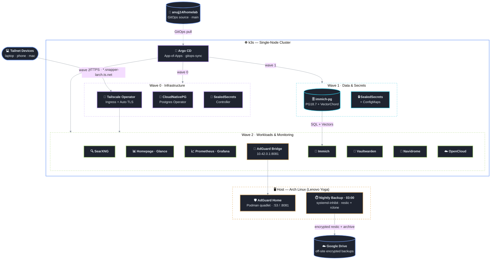

<div align="center">

# 🛰️ anuj's homelab

**A single-node k3s cluster on Arch Linux. Declarative, GitOps-driven, reachable only from the tailnet.**

**k3s · Argo CD · Tailscale · CloudNativePG · SealedSecrets · restic**

[](https://github.com/anujj14/homelab/actions/workflows/validate.yaml)
[](https://k3s.io)
[](https://argoproj.github.io/argo-cd)
[](https://tailscale.com)
[](https://cloudnative-pg.io)
[](https://github.com/bitnami-labs/sealed-secrets)

</div>

---

> The repo is the cluster. Everything Argo CD needs to build it — namespaces, charts, the Postgres cluster, sealed secrets, ingresses — lives here, and a nightly timer carries encrypted snapshots off the box. The node itself is disposable.

---

## 🧭 Overview



One Lenovo Yoga laptop running Arch Linux is the whole datacenter. k3s runs the workloads, Argo CD pulls this repo recursively (`cluster/infrastructure/` and `cluster/apps/`) and reconciles drift, and every Ingress goes through the Tailscale Kubernetes Operator — answering at `https://<app>.snapper-larch.ts.net` with automatic TLS, tailnet-only, zero ports forwarded to the internet.

AdGuard Home deliberately runs on the host as a Podman quadlet rather than inside k3s so LAN DNS survives cluster downtime. At 03:00 every night, a systemd timer snapshots the Immich library, Vaultwarden SQLite dump, and cluster secrets (including the SealedSecrets master key) into an encrypted `restic` repo and mirrors a whitelist to Google Drive with `rclone` (using `--backup-dir` so local deletions never wipe remote data).

## 📦 What's running

- **Immich** — photos, with ML smart search on Postgres 18 + VectorChord (pinned chart + app tag)
- **Vaultwarden** — passwords (pinned tag, isolated via `NetworkPolicy`)
- **Navidrome** — music (pinned tag)
- **OpenCloud** — file sync (pinned tag)
- **SearXNG** + Valkey — meta search (`searxng` runs `:latest` on purpose — rolling daily builds, stateless)
- **Homepage** & **Glance** — dashboards (run `:latest` on purpose — stateless, break loudly, nothing to lose)
- **kube-prometheus-stack** — Prometheus + Grafana tuned for laptop RAM (512Mi limit, 2-day retention)
- **AdGuard Home** — DNS for the LAN on the host as a Podman quadlet under systemd (pinned tag)

Underneath all of it: **Argo CD**, **Tailscale Operator**, **CloudNativePG**, and **SealedSecrets** (`cluster/infrastructure/`).

Everything is reachable on the tailnet at `https://<app>.snapper-larch.ts.net` — `immich.`, `vaultwarden.`, `navidrome.`, `opencloud.`, `searxng.`, `homepage.`, `glance.`, `argocd.`, `grafana.`, `adguard.`.

## 🔩 How it's put together

- **Argo CD App-of-Apps with recursive directory sync.** One root Application (`gitops-sync`) watches `cluster/` on `main` (`recurse: true`), split into `infrastructure/` and `apps/`. A second Application manages Argo CD's own Helm release. `dex`, `notifications`, and `applicationSet` are disabled.
- **Sync waves 0 → 1 → 2.** Wave 0 installs namespaces and operators (CloudNativePG, SealedSecrets, Tailscale Operator); wave 1 creates `immich-pg`, `SealedSecret` objects, and ConfigMaps; wave 2 deploys apps and monitoring. Cold boots converge without CRD race conditions.
- **ServerSideApply on CNPG and `kube-prometheus-stack`.** Their CRDs exceed client-side apply's 256KiB `last-applied-configuration` annotation limit.
- **Postgres as an operator, not a chart sidecar.** `immich-pg` is a CNPG Cluster on stock PG18 with VectorChord loaded via the `extensions` stanza. A `NetworkPolicy` restricts port `5432` strictly to `immich-server` pods while allowing `cnpg-system` (`8000`) and `monitoring` (`9187`).
- **100% SealedSecrets in Git.** Every app secret — including `searxng-secret`, `vaultwarden-admin`, `opencloud-secrets`, `homepage-secrets`, and `grafana-admin-credentials` — is encrypted with `kubeseal` and committed inline.
- **Storage pragmatic for a single node.** `immich-library` uses a static `hostPath` PV with `persistentVolumeReclaimPolicy: Retain` so chart bumps or prunes cannot delete photos. Lightweight stateful apps (`Vaultwarden`, `Navidrome`, `OpenCloud`) use direct `hostPath` mounts; `immich-pg` uses k3s `local-path`.
- **Resource bounds, probes, and least privilege.** Every workload defines CPU/memory requests and memory limits (avoiding unnecessary CPU throttling), health probes, and hardened `securityContext` (`allowPrivilegeEscalation: false`, `drop: [ALL]`, `seccompProfile: RuntimeDefault`).
- **Encrypted nightly backups.** The 03:00 timer runs under `systemd-inhibit`, dumps Vaultwarden via `sqlite3 .backup` and exports the SealedSecrets master key + Argo CD secret into `restic` alongside the Immich library (which includes Immich's own 02:00 database dump), prunes old snapshots (`7d / 4w / 6m`), and syncs to Google Drive with `--backup-dir` protection. The `restic` password lives at `~/.config/restic/password` (`chmod 600`) and is never uploaded to Google Drive.
- **CI + Renovate.** GitHub Actions runs `gitleaks`, `shellcheck`, `yamllint`, and pinned `kubeconform` on every push/PR. Renovate opens weekly PRs for Helm charts, Kubernetes images, Immich's nested app tag, and the AdGuard quadlet.

## 🚀 Bootstrap from bare metal
<details>
<summary><b>The steps</b></summary>

From a blank Arch install to a synced cluster. Assumes my paths and tailnet domain (`/home/anuj`, `snapper-larch.ts.net`); adjust for yours.

1. **Host directories** — every `hostPath` in `cluster/` and `system/`:

   ```bash
   sudo mkdir -p /home/anuj/{immich-app/library,vaultwarden/data,navidrome/data,navidrome/music,opencloud/config,opencloud/data,adguard/work,adguard/conf,immich-encrypted-backup,documents,kubernetes-backups,backups}
   # Immich containers run as uid 3000; the library must belong to them
   sudo chown -R 3000:3000 /home/anuj/immich-app/library

   ```
2. **k3s** — default install (every Ingress uses `ingressClassName: tailscale`):

   ```bash
   curl -sfL https://get.k3s.io | sh -s - server
   sudo systemctl enable --now k3s
   mkdir -p ~/.kube && sudo cp /etc/rancher/k3s/k3s.yaml ~/.kube/config && sudo chown "$(id -u):$(id -g)" ~/.kube/config

   ```
3. **Host services & restic password** — AdGuard quadlet and nightly backup units:

   ```bash
   mkdir -p ~/.config/containers/systemd ~/.config/systemd/user ~/.config/restic ~/.local/bin
   # Place your offline restic passphrase here (never stored in Google Drive)
   chmod 600 ~/.config/restic/password
   cp system/adguard.container ~/.config/containers/systemd/
   cp system/homelab-backup.{service,timer} ~/.config/systemd/user/
   cp system/ultimate-backup.sh ~/.local/bin/ && chmod 700 ~/.local/bin/ultimate-backup.sh
   systemctl --user daemon-reload
   systemctl --user enable --now adguardhome.service homelab-backup.timer

   ```
4. **Tailscale Operator OAuth credentials** — required before wave 0 brings up `tailscale-operator`:

   ```bash
   kubectl create namespace tailscale
   kubectl -n tailscale create secret generic operator-oauth \
     --from-literal=client_id='<tailscale-oauth-client-id>' \
     --from-literal=client_secret='<tailscale-oauth-client-secret>'

   ```
5. **Argo CD bootstrap** — install once by hand, then hand ownership to Git:

   ```bash
   helm repo add argo https://argoproj.github.io/argo-helm
   helm install argocd argo/argo-cd -n argocd --create-namespace
   kubectl apply -f cluster/infrastructure/argocd.yaml

   ```
6. **Restore the SealedSecrets master key** — pull from your encrypted `restic` backup (`kubernetes-backups/sealed-secrets-key.yaml`) after wave 0 brings up the controller:

   ```bash
   kubectl apply -f /tmp/restore/home/anuj/kubernetes-backups/sealed-secrets-key.yaml
   kubectl -n kube-system rollout restart deploy/sealed-secrets-controller

   ```
   All committed `SealedSecret` manifests unseal on the next reconcile.
7. **Let the waves converge** — wave 0 (operators) → wave 1 (`immich-pg` + secrets) → wave 2 (apps):

   ```bash
   kubectl get apps -n argocd -w
   kubectl -n immich get cluster immich-pg -w

   ```
8. **Data restores** — restore `rclone` directories first, then overwrite with clean dumps from `restic`:

   ```bash
   # Pull restic repo + non-secret app data from Google Drive
   rclone copy gdrive:Homelab/immich-encrypted-backup /home/anuj/immich-encrypted-backup --transfers 8
   rclone copy gdrive:Homelab/vaultwarden /home/anuj/vaultwarden --transfers 8
   rclone copy gdrive:Homelab/navidrome /home/anuj/navidrome --transfers 8
   rclone copy gdrive:Homelab/opencloud /home/anuj/opencloud --transfers 8

   # Decrypt latest restic snapshot (Immich library + Vaultwarden clean dump + cluster secrets)
   restic -r /home/anuj/immich-encrypted-backup \
     --password-file /home/anuj/.config/restic/password \
     restore latest --target /tmp/restore

   # Overwrite Vaultwarden DB with the clean sqlite3 .backup snapshot
   cp /tmp/restore/home/anuj/kubernetes-backups/vaultwarden.sqlite3 /home/anuj/vaultwarden/data/db.sqlite3

   # Restore Immich library
   rsync -a /tmp/restore/home/anuj/immich-app/library/ /home/anuj/immich-app/library/
   sudo chown -R 3000:3000 /home/anuj/immich-app/library

   # Restore Immich Postgres DB from Immich's 02:00 gzipped SQL dump into pod immich-pg-1
   LATEST_DUMP=$(ls -t /home/anuj/immich-app/library/backups/immich-db-backup-*.sql.gz | head -n 1)
   gunzip -c "$LATEST_DUMP" | kubectl -n immich exec -i immich-pg-1 -- psql -U immich -d immich

   ```
9. **Verify**:

   ```bash
   kubectl get apps -n argocd
   kubectl get pods -A | grep -vE 'Running|Completed'
   for h in immich vaultwarden navidrome opencloud searxng homepage glance argocd adguard grafana; do
     curl -s -o /dev/null -w "$h %{http_code}\n" "https://${h}.snapper-larch.ts.net"
   done
   dig @127.0.0.1 example.com +short
   systemctl --user list-timers | grep homelab

   ```
</details>

## 🔧 Working on it

Pre-push validation (matches CI):

```bash
shellcheck system/*.sh
yamllint -c .yamllint.yaml cluster/
kubeconform -strict -summary -ignore-missing-schemas \
  -schema-location default \
  -schema-location 'https://raw.githubusercontent.com/datreeio/CRDs-catalog/main/{{.Group}}/{{.ResourceKind}}_{{.ResourceAPIVersion}}.json' \
  cluster/

```

Sealing a secret (controller is `sealed-secrets-controller` in `kube-system`):

```bash
kubectl -n homepage create secret generic homepage-secrets \
    --from-literal=immich-key='...' \
    --dry-run=client -o yaml \
  | kubeseal --controller-namespace kube-system -o yaml >> cluster/apps/homepage.yaml

# Single raw value:
printf '%s' 'value' | kubeseal --raw --namespace searxng --name searxng-secret \
  --controller-namespace kube-system --from-file=/dev/stdin

```

Toggling monitoring off/on — moving the file **is** the switch:

```bash
git mv cluster/infrastructure/observability.yaml paused/   # off — gitops-sync prunes the app

```

## 🔍 When something's off

```bash
kubectl get apps -n argocd                  # app sync & health
kubectl get pods -A | grep -vE 'Running|Completed'
kubectl -n <namespace> logs <pod> --previous
kubectl -n <namespace> describe pod <pod>
sudo crictl ps -a                           # containerd layer
sudo journalctl -u k3s -f                   # node logs
journalctl --user -u homelab-backup.service # nightly backup logs

```

## 📁 Repo layout

```plaintext
.
├── cluster/                            # Argo CD gitops-sync root (recurse: true)
│   ├── infrastructure/                 # wave 0–1 platform & operators
│   │   ├── argocd.yaml                 # Argo CD self-management + gitops-sync root app
│   │   ├── cloudnative.yaml            # CNPG operator + immich-pg Cluster + NetworkPolicy
│   │   ├── sealed-secrets.yaml         # Bitnami SealedSecrets controller (kube-system)
│   │   ├── tailscale-operator.yaml     # Tailscale Ingress + TLS operator
│   │   └── observability.yaml          # kube-prometheus-stack + Grafana
│   └── apps/                           # wave 2 user workloads
│       ├── immich.yaml                 # Immich + static PV/PVC (Retain) + Ingress
│       ├── vaultwarden.yaml            # Vaultwarden + SealedSecret + NetworkPolicy
│       ├── navidrome.yaml
│       ├── opencloud.yaml
│       ├── searxng.yaml                # SearXNG + Valkey + SealedSecret
│       ├── homepage.yaml / glance.yaml # Dashboards (shared namespace & SealedSecret)
│       └── adguard-proxy.yaml          # EndpointSlice bridge to host AdGuard (:8081)
├── system/                             # Host-level units & scripts (outside Argo CD)
│   ├── adguard.container               # Podman quadlet — AdGuard Home (:53 DNS, :8081 admin)
│   ├── homelab-backup.service / .timer # 03:00 oneshot under systemd-inhibit
│   └── ultimate-backup.sh              # sqlite + secrets → restic (encrypted) → rclone
├── .github/workflows/validate.yaml     # gitleaks + shellcheck + yamllint + kubeconform
├── .yamllint.yaml
├── .gitignore
├── renovate.json                       # Weekly PRs for charts, images, Immich tag & quadlets
└── LICENSE                             # Apache 2.0

```

## ⚠️ Small print

- `prune: true` is real — `git rm` a manifest and the workload is gone. `git rm` `immich-pg` and you've deleted the database.
- The Immich library must be owned by `3000:3000`, or the server pod crashes on boot.
- `SealedSecret` objects bind to name + namespace. Move an app to a new namespace, re-seal its secrets in the same PR.
- Moving an Ingress between namespaces makes the Tailscale operator provision `<name>-1.snapper-larch.ts.net`. Delete the stale operator Service in the old namespace in the same change.
- Argo CD green ≠ working app. Sync health is not workload health — check pods.
- A rollback without `git revert` doesn't stick — `selfHeal: true` converges the cluster back to Git.

## 🚧 Still building

- [ ] Replace `opencloud.yaml` `hostAliases` with CoreDNS forwarding (`*.snapper-larch.ts.net` → `100.100.100.100`)
- [ ] Alerting on degraded pods and failed nightly backups (Alertmanager or Argo CD notifications)
- [ ] Bare-metal restore drill into a test VM to verify real RTO/RPO
- [ ] Dedicated hardware someday — for now, a laptop is doing the job

## 🫡 Acknowledgements

- [**k3s**](https://k3s.io) · [**Argo CD**](https://argoproj.github.io/argo-cd) · [**Tailscale**](https://tailscale.com) · [**CloudNativePG**](https://cloudnative-pg.io) + [**VectorChord**](https://github.com/tensorchord/VectorChord) · [**Bitnami SealedSecrets**](https://github.com/bitnami-labs/sealed-secrets) · [**restic**](https://restic.net) + [**rclone**](https://rclone.org)
- And Immich, Vaultwarden, Navidrome, OpenCloud, SearXNG, Homepage, Glance, AdGuard Home — the actual point of the cluster.

<div align="center">

<sub>Built for me. Take what's useful.</sub>

</div>
