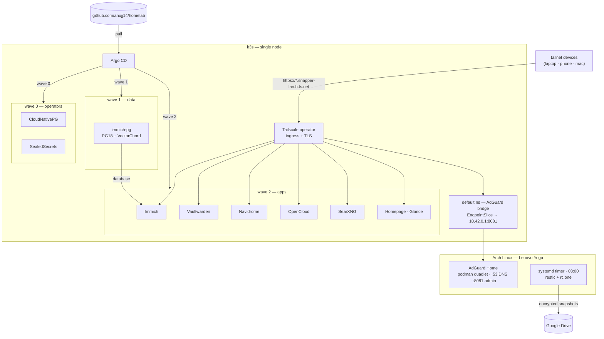

<div align="center">

# 🛰️ anuj's homelab

**A single-node k3s cluster on Arch Linux. Declarative, GitOps-driven, reachable only from the tailnet.**

**k3s · Argo CD · Tailscale · CloudNativePG · SealedSecrets · restic**

[](https://k3s.io)
[](https://argoproj.github.io/argo-cd)
[](https://tailscale.com)
[](https://cloudnative-pg.io)
[](https://github.com/bitnami-labs/sealed-secrets)
[](https://immich.app)

</div>

---

> The repo is the cluster. Everything Argo CD needs to build it — namespaces, charts, the Postgres cluster, sealed secrets, ingresses — lives here, and a nightly timer carries the data off the box. The node itself is disposable.

---

## 🧭 Overview



One Lenovo Yoga laptop running Arch Linux is the whole datacenter. k3s runs the apps, Argo CD pulls this repo and keeps them in shape, and every ingress goes through the Tailscale Kubernetes Operator — so everything answers at `https://<app>.snapper-larch.ts.net` with valid certs, tailnet only, nothing forwarded to the internet. AdGuard DNS deliberately lives on the host as a podman quadlet rather than inside k3s, so DNS doesn't depend on the cluster being up.

The bottom of the diagram is the recovery story: a 03:00 systemd timer snapshots the Immich library with restic and mirrors a whitelist to Google Drive with rclone.

---

## 📦 What's running

- **Immich** — photos, with ML smart search on Postgres + VectorChord
- **Vaultwarden** — passwords
- **Navidrome** — music
- **OpenCloud** — file sync
- **SearXNG** + Valkey — meta search
- **Homepage** & **Glance** — dashboards (run `:latest` on purpose; they break loudly and there's nothing to lose)
- **kube-prometheus-stack** — metrics + Grafana
- **AdGuard Home** — DNS for the LAN, on the host as a Podman quadlet under systemd. Not in the cluster on purpose: DNS stays up even when the cluster is down, and nothing inside the cluster can take it out.

Underneath all of it: Argo CD, the Tailscale operator, CloudNativePG and SealedSecrets run the place.

Everything is reachable on the tailnet at `https://<app>.snapper-larch.ts.net` — `immich.`, `navidrome.`, `vaultwarden.` … same pattern for the rest.

---

## 🔩 How it's put together

- **Argo CD runs an app-of-apps.** One root Application (`gitops-sync`) directory-syncs everything in `cluster/`, and a second Application manages Argo CD's own Helm release. ApplicationSet, dex and notifications are disabled — I don't use them.
- **Sync waves 0 → 1 → 2.** Wave 0 installs the operators (CloudNativePG, SealedSecrets), wave 1 creates the Postgres cluster (its CRD has to exist before the manifest can even validate), wave 2 deploys Immich (it needs the database). A cold boot converges instead of deadlocking.
- **ServerSideApply on the CNPG and kube-prometheus-stack apps.** Their CRDs are too big for client-side apply's 256KiB last-applied annotation limit.
- **Postgres as an operator, not a chart sidecar.** `immich-pg` is a CNPG Cluster on a stock PG18 image with VectorChord injected through the extensions stanza — Immich's smart search needs it, and bundled vector images lag behind on PG majors. The app role gets SUPERUSER because Immich's migrations manage extensions at runtime, same as upstream's docker-compose.
- **Secrets in git.** SealedSecrets encrypted with `kubeseal`, committed inline with their app manifests. The controller unseals in-cluster; the master sealing key stays off-cluster, where a repo leak can't reach it.
- **Ingress through the Tailscale operator.** Per-app HTTPS on the tailnet with automatic certs — no ingress-nginx, no cert-manager, no open ports. Every Ingress declares `spec.tls`, so nothing serves plaintext by accident.
- **hostPath volumes with `Retain`.** On one node, replication would be theater. Static PVs with `Retain` mean no chart bump or prune accident can delete the photo library.
- **Requests and limits on every workload** — cheap insurance that one runaway pod can't starve the node.
- **Backups.** A 03:00 systemd timer: Vaultwarden's sqlite gets a `.backup`, cluster secrets get dumped, restic snapshots the Immich library, rclone mirrors a whitelist to Google Drive. It runs under `systemd-inhibit` so the machine doesn't sleep halfway through. Immich dumps its own database at 02:00 into the library folder, so it rides the same snapshot — no separate DB job needed.
- **CI + Renovate.** GitHub Actions runs yamllint + kubeconform on every push, so malformed YAML never reaches the cluster. Renovate PRs chart and image bumps, automerge off.

---

## 🚀 Bootstrap from bare metal

From a blank Arch install to a synced cluster — the steps I'd run again. Assumes my paths and hostnames (`/home/anuj`, `snapper-larch.ts.net`); change what doesn't match yours.

<details>
<summary><b>The steps</b></summary>

1. **Host directories** — every hostPath in `cluster/` and `system/`:

   ```bash
   sudo mkdir -p /home/anuj/{immich-app/library,vaultwarden/data,navidrome/data,navidrome/music,opencloud/config,opencloud/data,adguard/work,adguard/conf,immich-encrypted-backup,documents,kubernetes-backups,backups}
   # Immich containers run as uid 3000; the library must belong to them
   sudo chown -R 3000:3000 /home/anuj/immich-app/library
   ```

2. **k3s** — default install. Traefik ships holding 80/443, but every Ingress here is `ingressClassName: tailscale`, so nothing routes through it:

   ```bash
   curl -sfL https://get.k3s.io | sh -s - server
   sudo systemctl enable --now k3s
   export KUBECONFIG=/etc/rancher/k3s/k3s.yaml
   ```

3. **Host services** — the AdGuard quadlet and the backup units:

   ```bash
   mkdir -p ~/.config/containers/systemd ~/.config/systemd/user ~/.local/bin
   cp system/adguard.container ~/.config/containers/systemd/
   cp system/homelab-backup.{service,timer} ~/.config/systemd/user/
   cp system/ultimate-backup.sh ~/.local/bin/ && chmod +x ~/.local/bin/ultimate-backup.sh
   systemctl --user daemon-reload
   systemctl --user enable --now adguardhome.service homelab-backup.timer
   ```

4. **Argo CD bootstrap** — install the chart once by hand, then hand the release to the repo:

   ```bash
   helm repo add argo https://argoproj.github.io/argo-helm
   helm install argocd argo/argo-cd -n argocd --create-namespace
   kubectl apply -f cluster/argocd.yaml   # 'argocd' (adopts the release) + 'gitops-sync' (root app)
   ```

   From here on, everything comes from Git.

5. **Restore the sealing key** — after wave 0 brings up the controller, before caring about anything encrypted:

   ```bash
   kubectl -n kube-system create secret tls sealed-secrets-key-restored \
     --cert=sealed-secrets.crt --key=sealed-secrets.key
   kubectl -n kube-system label secret sealed-secrets-key-restored \
     sealed-secrets.bitnami.com/sealed-secrets-key=active
   kubectl -n kube-system rollout restart deployment/sealed-secrets-controller
   ```

   Committed SealedSecrets unseal on the next reconcile. If the Argo CD admin password matters, restore `argocd-secret` from the backup dump instead of taking the freshly generated one.

6. **The one manual secret**:

   ```bash
   kubectl -n searxng create secret generic searxng-secret \
     --from-literal=SEARXNG_SECRET=$(openssl rand -hex 32)
   ```

7. **Let the waves land** — wave 0 (operators) → wave 1 (fresh Postgres) → wave 2 (apps):

   ```bash
   watch kubectl get apps -n argocd
   kubectl -n immich get cluster/postgresql.cnpg.io/immich-pg -w
   ```

8. **Data restores**:

   ```bash
   # Vaultwarden
   cp kubernetes-backups/vaultwarden.sqlite3 /home/anuj/vaultwarden/data/db.sqlite3

   # Immich library from restic (the local repo is mirrored inside gdrive:Homelab)
   restic -r /home/anuj/immich-encrypted-backup \
     --password-file /home/anuj/documents/restic-password.txt \
     restore latest --target /tmp/immich-restore
   rsync -a /tmp/immich-restore/home/anuj/immich-app/library/ /home/anuj/immich-app/library/
   sudo chown -R 3000:3000 /home/anuj/immich-app/library

   # The database: Immich's own 02:00 dump comes back with the library —
   # pg_restore it into the fresh cluster
   kubectl -n immich cp immich.dump immich-pg-rw:/tmp/
   kubectl -n immich exec immich-pg-rw -- pg_restore -U immich -d immich --clean --if-exists /tmp/immich.dump

   # Everything else straight from the drive
   rclone copy gdrive:Homelab/vaultwarden /home/anuj/vaultwarden --transfers 8
   ```

9. **Verify**:

   ```bash
   kubectl get apps -n argocd                # all Synced/Healthy
   kubectl get pods -A | grep -v Completed  # no CrashLoopBackOff
   for h in immich vaultwarden navidrome opencloud searxng homepage glance argocd adguard grafana; do
     curl -s -o /dev/null -w "$h %{http_code}\n" https://$h.snapper-larch.ts.net; done
   dig @127.0.0.1 example.com +short        # AdGuard answering DNS on the host
   systemctl --user list-timers | grep homelab
   ```

</details>

---

## 🔧 Working on it

Pre-push validation — the same checks CI runs, plus the server-side dry-run CI can't:

```bash
yamllint -c .yamllint.yaml cluster/
kubeconform -strict -summary -ignore-missing-schemas \
  -schema-location default \
  -schema-location 'https://raw.githubusercontent.com/datreeio/CRDs-catalog/main/{{.Group}}/{{.ResourceKind}}_{{.ResourceAPIVersion}}.json' \
  cluster/
kubectl apply --dry-run=server -f cluster/immich.yaml
```

Sealing a new secret (controller is `sealed-secrets-controller` in `kube-system`):

```bash
kubectl -n homepage create secret generic homepage-secrets \
    --from-literal=immich-key='...' \
    --dry-run=client -o yaml \
  | kubeseal --controller-namespace kube-system -o yaml >> cluster/homepage.yaml
# single raw value:
echo -n 'value' | kubeseal --raw --namespace searxng --name searxng-secret \
  --controller-namespace kube-system --from-file=/dev/stdin
```

Turning monitoring off or on — moving the file **is** the switch:

```bash
git mv cluster/observability.yaml somewhere-outside-cluster/   # off — gitops-sync prunes the app
```

---

## 🔍 When something's off

Argo CD tells me sync health. These are the commands I actually reach for when diagnosing by hand:

```bash
kubectl get apps -n argocd                  # app status without the UI
kubectl get pods -A | grep -v Running      # anything unhealthy, cluster-wide
kubectl -n <namespace> logs <pod> --previous
kubectl -n <namespace> describe pod <pod>  # the events usually name the problem

# below kubernetes, on the node itself
sudo crictl ps -a                          # what containerd is actually running
sudo crictl logs <id>
sudo journalctl -u k3s -f                   # the node

# what helm thinks it owns
helm list -A
```

---

## 📁 Repo layout

```text
.
├── cluster/                 # the sync path — gitops-sync reconciles everything in here
│   ├── argocd.yaml          # Argo CD self-management + the gitops-sync root app
│   ├── cloudnative.yaml     # CNPG operator (wave 0) + immich-pg Cluster (wave 1) + NetworkPolicy
│   ├── sealed-secrets.yaml  # controller (wave 0, kube-system)
│   ├── tailscale-operator.yaml
│   ├── observability.yaml   # kube-prometheus-stack + Grafana
│   ├── immich.yaml          # Immich app (wave 2) + static PV/PVC + ingress
│   ├── vaultwarden.yaml     # ns + deployment + sealed secret
│   ├── navidrome.yaml
│   ├── opencloud.yaml
│   ├── searxng.yaml         # app + valkey + settings ConfigMap
│   ├── homepage.yaml / glance.yaml   # dashboards — shared namespace, shared sealed secret
│   └── adguard-proxy.yaml   # default-ns bridge to host AdGuard
├── system/                  # host-level, applied by hand — not synced by Argo CD
│   ├── adguard.container    # Podman quadlet — AdGuard Home (DNS :53, admin 8081)
│   ├── homelab-backup.service / .timer   # 03:00 oneshot
│   └── ultimate-backup.sh   # sqlite + secret dumps → restic → rclone
├── .github/workflows/validate.yaml      # yamllint + kubeconform on push/PR
├── .yamllint.yaml
└── renovate.json            # chart/image bumps, automerge off
```

---

## ⚠️ Small print

- `prune: true` is real — `git rm` a manifest and the workload is gone from the cluster. `git rm` the `immich-pg` Cluster and you've deleted the database.
- The Immich library must be owned by `3000:3000`, or the server pod crashes on boot.
- SealedSecrets bind to name + namespace. Move an app to a new namespace, re-seal its secrets in the same change.
- Moving an Ingress between namespaces makes the Tailscale operator re-provision and answer as `<name>-1.snapper-larch.ts.net`. Delete the stale operator Service in the old namespace in the same change.
- Argo CD green ≠ working app. Sync health is not workload health — check pods.
- A rollback without a `git revert` doesn't stick — selfHeal converges the cluster back to whatever Git says.

---

## 🚧 Still building

- [ ] notifications when an app degrades (Alertmanager or Argo CD notifications — one of them)
- [ ] an occasional restore drill, to keep this README honest
- [ ] real hardware someday — for now, a laptop is doing the job

---

## 🫡 Acknowledgements

- [**k3s**](https://k3s.io) — single-binary Kubernetes.
- [**Argo CD**](https://argoproj.github.io/argo-cd) — this repo is one app-of-apps.
- [**Tailscale**](https://tailscale.com) — ingress and TLS with zero forwarded ports.
- [**CloudNativePG**](https://cloudnative-pg.io) + [**VectorChord**](https://github.com/tensorchord/VectorChord) — Postgres as an operator, with the smart search.
- [**Bitnami SealedSecrets**](https://github.com/bitnami-labs/sealed-secrets) — secrets that can live in git.
- [**restic**](https://restic.net) + [**rclone**](https://rclone.org) — the part that lets me sleep.
- And Immich, Vaultwarden, Navidrome, OpenCloud, SearXNG, Homepage, Glance — the actual point of the cluster.

---

<div align="center">

<sub>Built for me. Take what's useful.</sub>

</div>

